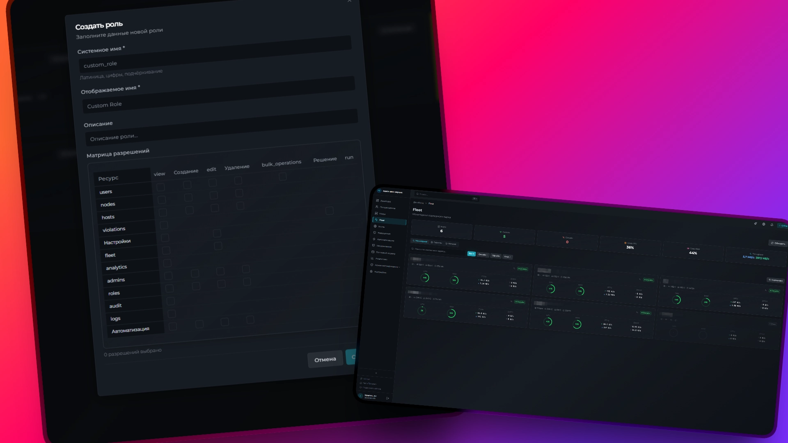
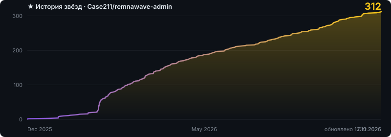

# Remnawave Admin

**Панель управления и Telegram-бот поверх вашей панели Remnawave**

Пользователи, ноды, анти-абуз, почта и мониторинг — в одном месте

  

### [🌐 Сайт](https://nexuslink.ru) · [💬 Чат](https://t.me/remnawave_admin) · [🛟 Поддержка](https://t.me/rwa_moder_bot?start=support)

[English](README_EN.md) · Русский

---

> [!IMPORTANT]
> **Remnawave Admin теперь платный.** Актуальная версия развивается отдельно и работает по подписке: первые 3 недели — бесплатно и с полным набором функций, дальше помесячно, цена зависит от размера сервиса. Цена, условия и регистрация — на **[nexuslink.ru](https://nexuslink.ru)**.
>
> Здесь осталась последняя бесплатная версия **5.2.0**. Она работает, но больше не обновляется.

Панель Remnawave отвечает за пользователей и конфигурацию. Remnawave Admin берёт на себя всё остальное: собирает подключения с нод, ищет разделение подписок и торренты, принимает меры, шлёт уведомления, хранит историю и показывает, что происходит.

Работает поверх вашей панели по API, данные держит в своей базе.

## Возможности

🛡 **Анти-абуз.** Анализаторы подключений ищут разделение подписки и накрутку пробных: одновременные подключения, «невозможные путешествия», сети, устройства, HWID, User-Agent. Меры — от предупреждения клиенту до ограничения скорости и отключения — можно включить автоматически, а каждое нарушение разобрать в его карточке.

🧲 **Торренты.** Тег роутинга Xray и разбор трафика на ноде: шифрованный BitTorrent тоже видно, а лаунчеры игр и синхронизацию файлов можно отметить как «не торрент».

🛰 **Агент на нодах.** Логи Xray, метрики хоста, удалённый терминал и каталог скриптов, ограничение скорости на ноде, качество канала до клиентов. Ставится одной строкой из панели.

🚨 **Атаки и сбои.** Детектор DDoS-атак на ноды, тревоги о падении нод и о проблемах с каналом.

📧 **Почтовый сервер.** Свой MX, DKIM, приём входящих, проверка SPF/DKIM/DMARC — без внешних SMTP-провайдеров.

📈 **Мониторинг и аналитика.** Метрики Prometheus и дашборды Grafana, гео-карта подключений, рейтинг хостеров, аналитика по пользователям и нодам.

🤖 **Telegram-бот.** Управление из чата, уведомления с кнопками действий, раскладка по топикам форума.

🔌 **API и интеграции.** Свой API с ключами и правами, webhook с подписью, нарушения в кабинете Bedolaga.

А также: конструктор автоматизаций, бэкапы по расписанию, журнал действий, роли и права, 2FA, темы оформления, русский и английский.

## Как начать

1. Зайдите на [nexuslink.ru](https://nexuslink.ru) и войдите в личный кабинет через Telegram.
2. Выпустите токен установки — инструкция и документация откроются там же.
3. Поставьте админку на свой сервер с Docker, лучше отдельный от панели. Первые 3 недели — бесплатно.

Вопросы — в [чат](https://t.me/remnawave_admin) или в поддержку [@rwa_moder_bot](https://t.me/rwa_moder_bot?start=support).

## Бесплатная версия 5.2.0

Код в этом репозитории — последняя бесплатная версия. Её [документация](https://case211.github.io/remnawave-admin/) и [релиз](https://github.com/Case211/remnawave-admin/releases/tag/5.2.0) остаются на месте, но обновлений, исправлений и поддержки у неё больше не будет, pull request не принимаются.

## Лицензия

Код этого репозитория — GNU AGPL v3.0 с исключением для плагинов (§7), см. [LICENSE](LICENSE); версии до 2.15.x включительно остаются под MIT. Платная версия — отдельный продукт, её условия — в [пользовательском соглашении](https://nexuslink.ru/terms.html).

## Поддержать

TON `UQDDe-jyFTbQsPHqyojdFeO1_m7uPF-q1w0g_MfbSOd3l1sC`
USDT TRC20 `TGyHJj2PsYSUwkBbWdc7BFfsAxsE6SGGJP`
BTC `1J6Zz7XcrpFkchwFmuU5WTFYTxziBdSwRz`

Сделано для сообщества Remnawave

